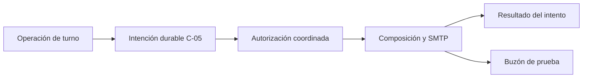

# Design

## Context

C-05 define identidad durable, elegibilidad, revisión, destinatario y registro de intentos. C-09 genera el evento de cambio en la transacción del turno. C-04 resuelve el material privado con su referencia aprobada. Fuentes: NO-01 a NO-07, especificación de autogestión y diseño archivado de C-05.

## Goals / Non-Goals

**Goals** — ejecutar FL-08/FL-09 dentro del backend local y preservar trazabilidad ante errores, concurrencia y reinicios.

**Non-Goals** — cuentas nuevas, integración pública, cambios en credenciales de gestión, interfaz o estados del turno.

Decision: no (no UI)

## Decisions

### Coordinación y recuperación

Consultar por lotes pequeños los despachos cuya hora de envío ya llegó y que siguen siendo elegibles. Autorizar bajo el coordinador de agenda de C-02 con reloj leído dentro de la sección coordinada, comprobar revisión, vencimiento e identidad y confirmar el intento durable antes de SMTP. Una lectura sin coordinación deja una carrera. Componer con la referencia aprobada y registrar el resultado fuera de la transacción del turno. La recuperación distingue intentos activos de intentos huérfanos y clasifica como incierto un intento sin resultado cuando no se pueda descartar aceptación. La detección deberá respetar un límite de ejecución y evitar dos emisores activos sobre el mismo despacho.



Aplicar NO-07 y el diseño archivado de C-05. Confirmación y cambio tienen objetivo de primer intento de 2 minutos y el recordatorio de 5 minutos. La confirmación vence al inicio, el cambio a las 24 horas del evento y el recordatorio dos horas después de su programación o al perder vigencia. El despacho combinado usa la primera ventana que cierre. Los tres intentos máximos con esperas de 1 y 5 minutos solo aplican a fallos transitorios conocidos y vigentes.

### Gmail de pruebas

La cuenta dedicada `grupo16desarrollosoftware3k10@gmail.com` es el usuario SMTP, el remitente y el único destinatario autorizado. Usar datos ficticios. Validar el destinatario persistido antes de SMTP y omitir el despacho si no coincide. El nombre visible propuesto es «Odontología — pruebas C-11». Se propone usar la dirección del remitente como destino de respuesta por defecto.

**Envío SMTP.** Usar `smtp.gmail.com:587` con autenticación, STARTTLS obligatorio y verificación del nombre del servidor. Mantener el emisor deshabilitado por defecto y el diagnóstico de protocolo desactivado. Se proponen 5 s para conexión, 10 s para lectura y escritura y 30 s de sondeo, sujetos a revisión HIGH. El titular habilita la verificación en dos pasos y crea una contraseña de aplicación dedicada a C-11, si Google ofrece la opción. La carga se hace con una entrada local sin eco en PowerShell y se limita al entorno del proceso del backend mediante `SPRING_MAIL_PASSWORD`. Evitar archivos en el repositorio, argumentos de línea de comandos, chat y logs. Quitar la variable al terminar y revocar la contraseña de aplicación cuando termine la campaña. Si la opción no está disponible, revisar OAuth 2.0 para SMTP antes de habilitar el emisor.

**Recepción.** Para la aceptación, el titular inicia sesión en Gmail web con la cuenta dedicada y entrega al agente únicamente esa sesión de prueba para comprobar los mensajes. La contraseña de aplicación queda en el backend. La sesión web permite operar la cuenta, por lo que la actuación del agente se limita a buscar y examinar los mensajes de la prueba y abrir el enlace local aplicable. No hay integración de lectura en el backend. Si se requiere verificación desatendida más adelante, revisar una autorización OAuth separada con Gmail API y alcance restringido `gmail.readonly`.

**Evidencia.** Correlacionar cada mensaje recibido con el despacho y registrar tipo, hora prevista, hora del intento, recepción y resultado de apertura local. En un envío a la misma cuenta, verificar la copia entrante o su condición de recibida por mensaje. La presencia de la conversación en Enviados o la aceptación SMTP por sí solas no acreditan recepción. Si la copia entrante no puede distinguirse, dejar el caso pendiente. Redactar direcciones, enlaces privados y datos innecesarios en la evidencia guardada.

Fuentes oficiales de Google: [Parámetros SMTP](https://support.google.com/mail/answer/7104828) · [Contraseñas de aplicación](https://support.google.com/accounts/answer/185833) · [Alcances de Gmail API](https://developers.google.com/workspace/gmail/api/auth/scopes).

### Aprobación HIGH

- Ignacio aprobó el 2026-11-25 STARTTLS 587, 5 s de conexión, 10 s de lectura y escritura, sondeo de 30 s y el nombre visible propuesto. Ignacio revisará los fallos definitivos o inciertos.
- Ignacio autorizó implementación y envíos de prueba entre la misma cuenta dedicada, con datos ficticios. La inspección web requiere que el titular habilite la sesión de prueba. Conservar evidencia redactada sin secretos ni enlaces privados.
- Preservar los enlaces y el mecanismo de C-04. Mantener las respuestas HTTP de C-09.

## Risks / Trade-offs

- Caída tras una posible aceptación SMTP → conservar incertidumbre y revisar sin reenvío automático.
- Cambio concurrente posterior a autorización → el intento previo puede terminar y llegar fuera de orden. Mantener su historial, impedir nuevos intentos obsoletos y respetar la revocación al componer.
- Remitente rechazado o correo filtrado → correlacionar resultados con la observación en buzón autorizado y documentar diferencias.
- Reiniciar o habilitar con avisos anteriores → revisar volumen y elegibilidad antes de habilitar, aplicar vencimiento y restricción de destinatarios.

## Migration Plan

Partir del esquema de C-05 y su historial. Cualquier cambio persistente imprescindible se describe y revisa bajo HIGH antes de editarlo. Mantener el emisor deshabilitado hasta habilitación explícita del entorno. Para detenerlo, deshabilitar el procesamiento y preservar intenciones e intentos para revisión y recuperación.

### Ejecución local de las pruebas reales

Usar una base aislada con datos ficticios y configurar Temurin 21, las variables locales del backend y el archivo de claves de C-04 según el README. Desde la raíz de la copia POSIX, habilitar el emisor solo durante la prueba autorizada.

```bash
(
  set +x
  read -r -s -p 'Contraseña de aplicación SMTP de C-11: ' SPRING_MAIL_PASSWORD || exit 1
  printf '\n'
  export SPRING_MAIL_PASSWORD
  trap 'unset SPRING_MAIL_PASSWORD' EXIT
  APP_MAIL_ENABLED=true bash ./backend/gradlew -p backend --no-daemon bootRun
)
```

El sondeo usa exclusión de sesión PostgreSQL para distinguir un intento abandonado de otro emisor activo. Después de conseguir la exclusión, recupera los intentos abiertos del buzón como inciertos y consulta avisos vigentes por lotes. La autorización conserva la coordinación de C-05.

Cuando hay material de gestión, el compositor usa `APP_BASE_URL` y agrega el segmento `gestionar-turno` con la credencial en el fragmento. Con la base local habitual, un ejemplo con material ficticio es `http://127.0.0.1:5173/gestionar-turno#credencial-ficticia`. La cancelación se compone sin enlace. La confirmación y el recordatorio combinados conservan un único mensaje con un solo enlace. La interfaz que abre el enlace corresponde a C-14.

Ignacio puede diagnosticar por identificador de intento con `resultado`, `autorizado_en` y `terminado_en` de `intento_notificacion`. Para evidencia, exportar solo esos campos y el identificador del despacho. Evitar volcar el destinatario y el contenido.
